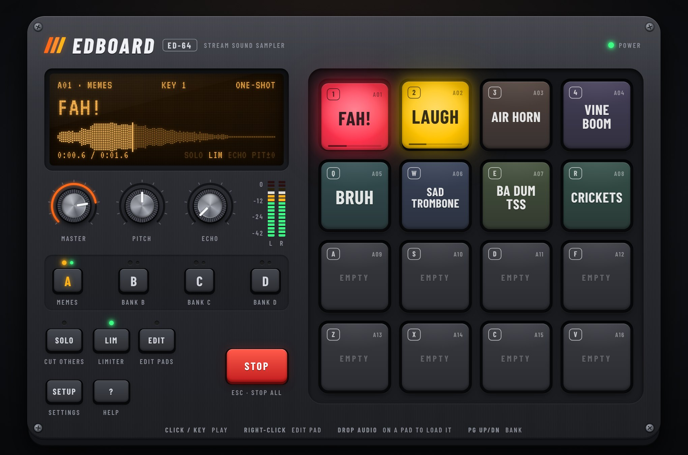

# EDBOARD

**A hardware-style soundboard for streamers.** Click a pad or hit a shortcut to fire a sound on stream — FAH!, air horn, ba-dum-tss, sad trombone and 28 more are built in, and you can drop your own clips onto any pad.



It looks and behaves like a piece of studio gear: rubber pads that press down and light up while their sound plays, an amber LCD with a live waveform and playhead, a master section with knurled knobs and LED level meters, bank buttons with activity LEDs, and a big red panic button.

## Features

- **64 pads in 4 banks** (4 × 4 grid, like an MPC / SP-404). Bank A is meme classics, bank B is sound effects, banks C and D are yours.
- **32 built-in sounds, no samples shipped.** Every built-in sound is synthesised in code at start-up (a formant voice synthesiser does the "FAH!", "BRUH", "OOF" and "WOW"), so there is no licensed audio in the repo and nothing to download.
- **Keyboard shortcuts laid out like the pads.** Bank A sits under your left hand (`1-4 / Q-R / A-F / Z-V`), bank B under your right (`5-8 / T-I / G-K / B-,`). Shortcuts work for every bank, whichever one is on screen, and can be re-bound to any key (numpad and F13–F24 for macro keyboards / Stream Deck included).
- **Your own sounds.** Drop MP3 / WAV / OGG / M4A / FLAC files on a pad (several files fill the next empty pads), or load them in the pad editor. Leading silence is trimmed and clips are loudness-levelled so nothing blows out your stream (switchable per pad).
- **Play modes per pad:** one-shot (re-press restarts), overlap (spam-friendly), hold (plays while held — perfect for the censor BLEEP), toggle, and loop.
- **Master section:** volume, vari-speed **pitch** (±12 semitones, chipmunk to demon), **echo** send, **SOLO** (one sound at a time), output **limiter**, stereo LED meters, and **STOP / Esc** to kill everything.
- **Output device routing** (Chrome / Edge): send the board to a virtual cable so it gets its own fader in OBS.
- **Everything is saved in your browser** — pads, keys, settings (localStorage) and your audio files (IndexedDB).
- **Scales like hardware:** landscape on desktops, a portrait unit on phones and tablets (multi-touch works), small enough for an OBS dock.

## Getting started

Requires Node.js 20.19+ or 22.12+.

```bash
npm install
npm run dev        # http://localhost:5173
```

Production build (static files in `dist/`, works from any sub-path, e.g. GitHub Pages):

```bash
npm run build
npm run preview
```

### Deploying

Edboard is a static site, so any static host works. On **Vercel**, import the repo and deploy the branch that contains the app (Vercel's production domain builds `main`). `vercel.json` pins the build (`npm run build` → `dist/`), so it builds correctly even if the project was created with the "Other" framework preset.

## Using it on stream

1. Open Edboard in your browser (or in OBS: **Docks → Custom Browser Docks**, paste the URL).
2. Sounds play through your default speakers, so OBS's **Desktop Audio** picks them up — no setup needed.
3. Want a separate fader for the soundboard? Press **SETUP** and choose a virtual audio cable (VB-CABLE, VoiceMeeter, BlackHole…) as the output, then add that cable to OBS as an **Audio Input Capture**.

> Keyboard shortcuts only work while the Edboard window has focus — browsers can't listen to keys while you're in a game. Click the board (or its OBS dock) first.

## Controls

| Action | How |
| --- | --- |
| Play a pad | Click / tap it, or press its key |
| Stop everything | **STOP** or `Esc` |
| Switch bank | **A B C D** buttons or `Page Up` / `Page Down` |
| Edit a pad (sound, name, key, colour, mode, volume) | Right-click it, or press **EDIT** then click it |
| Load your own sound | Drop an audio file on a pad, or use the pad editor |
| Swap two pads | **EDIT** mode, then drag one pad onto another |
| Knobs | Drag up/down, scroll, or arrow keys · double-click to reset · Shift for fine control |

## Built-in sounds

| Bank A — Memes | | | |
| --- | --- | --- | --- |
| `1` FAH! | `2` AIR HORN | `3` BA DUM TSS | `4` SAD TROMBONE |
| `Q` VINE BOOM | `W` BRUH | `E` CRICKETS | `R` APPLAUSE |
| `A` WRONG | `S` CORRECT | `D` DRUM ROLL | `F` DUN DUN DUN |
| `Z` SCRATCH | `X` BONK | `C` VICTORY | `V` BLEEP (hold) |

| Bank B — SFX | | | |
| --- | --- | --- | --- |
| `5` OOF | `6` WOW | `7` LASER | `8` EXPLOSION |
| `T` BOING | `Y` WHOOSH | `U` COIN | `I` POWER UP |
| `G` GAME OVER | `H` CHA-CHING | `J` HEARTBEAT | `K` ALARM |
| `B` COUNTDOWN | `N` SUSPENSE | `M` SLIDE WHISTLE | `,` GONG |

These are original synthesised takes on the classics, not the original meme recordings. If you have the exact clip you want (say, the original "FAH"), drop it onto the pad — your file replaces the built-in sound.

## How it works

```
src/
  audio/
    dsp/           Sample-level DSP: oscillators, filters, envelopes, Freeverb, BS.1770 loudness
    synth/         Built-in sound recipes, formant voice synth, render worker
    engine.ts      Web Audio playback: voices → echo → master → limiter → meters
    soundBank.ts   Decoded buffers for built-in and user sounds (+ levelling, silence trim)
  state/           Board model, reducer, persistence, IndexedDB file store, key labels
  app/             Soundboard controller (play modes, shortcuts, LCD messages) and React hooks
  components/      The hardware: Device, Pad, Lcd, Knob, LedMeter, HwButton, dialogs
```

- Built-in sounds are plain TypeScript functions that write samples into a buffer. They render deterministically in a pool of Web Workers at the audio device's sample rate, are levelled to −14 LUFS (momentary max), and then play as ordinary `AudioBuffer`s — so they start instantly.
- Pads trigger on `pointerdown` / `keydown` (not on release) for the lowest latency.
- To add a built-in sound, write a recipe in `src/audio/synth/sounds/` and register it in `src/audio/synth/library.ts`.

## Development

```bash
npm test           # unit tests (Vitest) — DSP, every built-in sound, board state
npm run lint       # oxlint
npm run typecheck  # tsc
```
